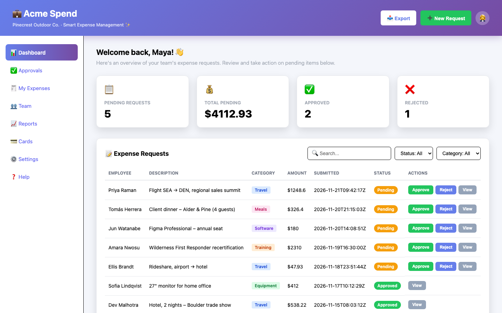
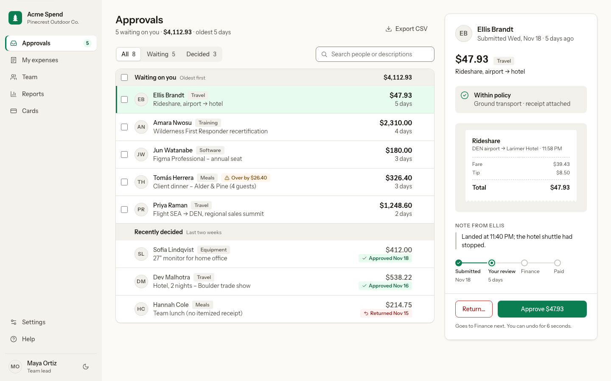

# ui-mode

Agent skills for UI work. Each skill lives in `skills/<name>/` with its own `SKILL.md`, the
layout the [`skills` CLI](https://github.com/vercel-labs/skills) discovers.

| Skill | What it does |
|---|---|
| [`ui-mode`](skills/ui-mode/README.md) | UI design mode: `/ui-mode build` designs and builds a UI in 12 checked steps; `/ui-mode review` audits a real UI and returns ranked findings with concrete fixes. |

## Example

An expense-approvals dashboard of the kind a model generates in one shot, run through
`/ui-mode review` and then `/ui-mode build`. Everything in
[`examples/expense-approvals`](examples/expense-approvals) is the skill's own output: the
[review](examples/expense-approvals/review.md), the [build log](examples/expense-approvals/build.md)
with dark-mode and 390 px shots, and both pages. The product, company, and people are fictional.

| Before (Stock rung) | After (Contextual rung) |
|---|---|
|  |  |

The review's verdict:

> A generated-template approvals dashboard whose biggest problem is that the lead approves
> money blind: no receipt, policy limit, or history is in view, Reject wears the brand's
> primary color at equal weight to Approve, and the whole queue breaks at 390 px.

It found 65 of the 124 tells and grouped them into 15 ranked findings. The five High ones:

| Finding | Principle |
|---|---|
| The lead approves money without the receipt, policy limit, note, or history; the per-row "View" does nothing | Decide |
| "Reject all pending" rejects $4,112.93 across five people with one optional comment | Decide |
| At 390 px the sidebar leaves 150 px for content and the table runs off the edge | Reality |
| Reject is a solid brand-color fill equal to Approve; 19 solid buttons on the first screen | Emphasis |
| White on the green Approve button is 2.28:1; footer text is 1.62:1 | Palette |

Each finding names its tells and a fix in concrete values. The build fixed them and ran the
review on its own output, which left five Low findings and no High or Medium.

## Install

The CLI needs Node.js 22.20 or later.

```sh
npx skills add chrisprijic/ui-mode                       # pick skills and agents interactively
npx skills add chrisprijic/ui-mode -g -a claude-code -y  # Claude Code, user-level, no prompts
npx skills add chrisprijic/ui-mode --list                # list skills without installing
```

Swap `claude-code` for your agent (`codex`, `cursor`, and the rest of the CLI's
[supported agents](https://github.com/vercel-labs/skills/blob/main/docs/agents.md)).
`npx skills update` pulls new versions.

Without the CLI, copy or link `skills/ui-mode` into your agent's skills folder, for example
`~/.claude/skills/ui-mode`.

## Add a skill

Create `skills/<name>/SKILL.md` with `name: <name>` (matching the folder) and `license: MIT`
in its frontmatter. Keep relative links inside the skill folder so they survive installation.

## Check

```sh
npm run check
```

Node 22 or later, no dependencies. It validates every skill, then runs the tests:

- frontmatter, relative links, and every `` `file.md` (Section) `` reference
- the counts the docs state in prose: tells, principles, build steps
- ui-mode's color tokens: WCAG contrast for each documented pairing and the sRGB gamut of the
  worked ramp, computed from the tables in `references/color.md` rather than trusted

CI runs it on every push to `main` and every pull request.

## License

[MIT](LICENSE). The skills are original writing. `skills/ui-mode/SOURCES.md` acknowledges the
works that inspired them; ui-mode is not affiliated with or endorsed by any of them, and the
license grants no rights in those works.
