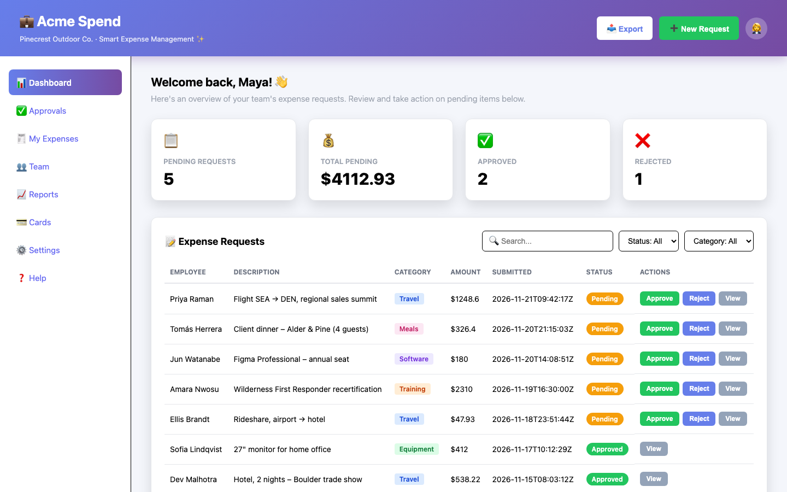
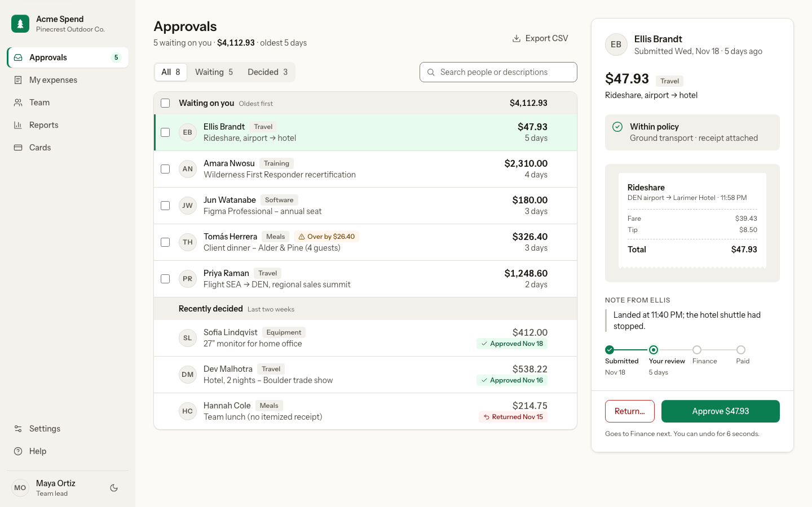
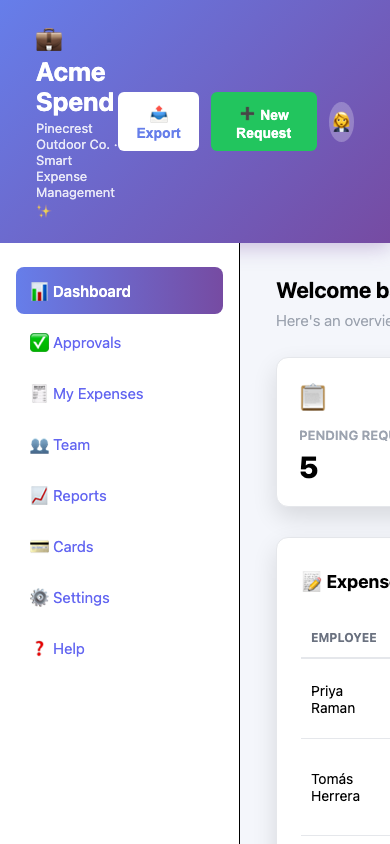
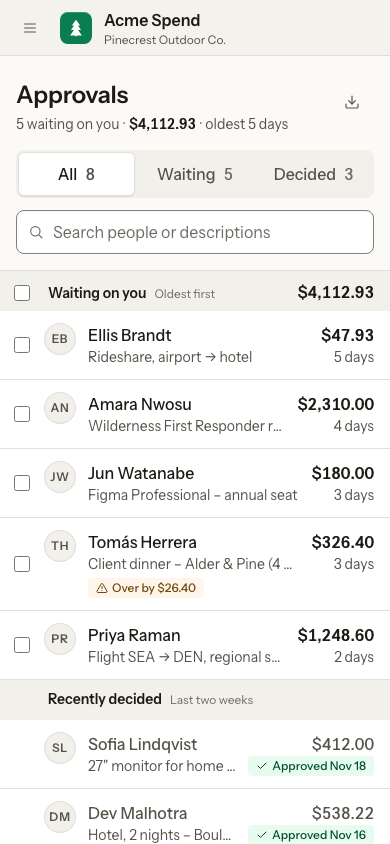
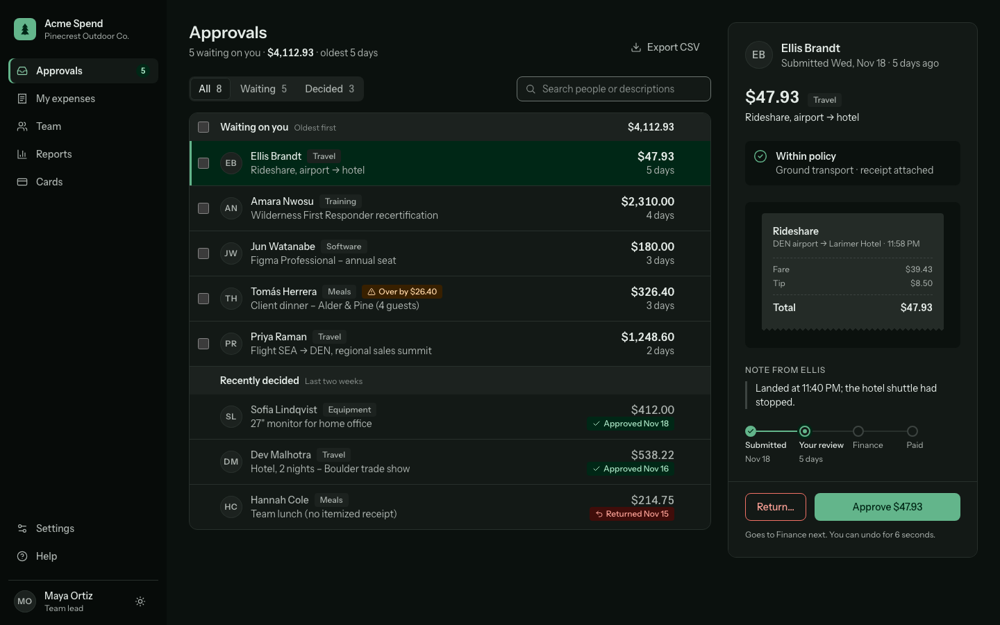
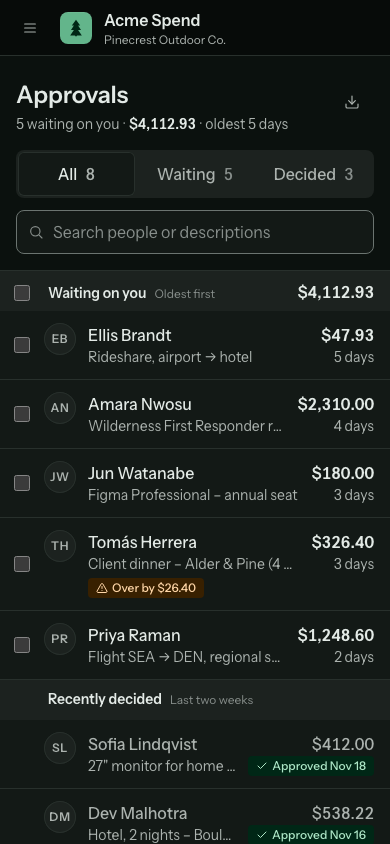

# ui-mode build: Acme Spend approvals, redesigned

**Goal.** Redesign `before/index.html` as `after/index.html` with the same people, amounts, categories, dates, and statuses, fixing the 15 findings in `review.md`.
**Surface.** App (SaaS dashboard) carrying a process. Each approval is a **commit** that moves money to Finance (`references/dashboard.md`, `references/processes.md`).
**Smallest UI that meets the goal.** One screen: a queue of requests and a review panel beside it. The panel holds the receipt, the policy check, the employee's note, the stage track, one primary "Approve $amount", and a quieter "Return…" that asks for a reason.

Process todo (playbook steps, verbatim, with status)

1. [x] **Baseline** (**Reality**). When the UI already exists, render it before changing anything: each screen and state in scope, at the **Reality** viewports and themes. Save the shots outside the repo; they're the *before* half of the proof.
   *Done when* every in-scope screen and state has before shots, or you've noted the UI is new.
   → `shots/before-1440-light.png`, `shots/before-390-light.png`, plus working captures at 1920×1080 and 1440×1300. The before has no dark theme and no other states to capture.
2. [x] **Frame** (**Opinion**, **Soul**). Answer the Opinion questions for this UI. Name the surface and read its reference. Choose the personality: typeface, color, radius, and voice.
   *Done when* the Opinion answers, the surface, and the personality are written down.
3. [x] **Feature first** (**Intent**, **Decide**, **Iterate**, **Emphasis**). For each key screen, write **the decision** the user makes there. List the content and its data shape, and **rank** each piece primary, secondary, or tertiary. Sketch it in grayscale at low fidelity, shell last.
   *Done when* each key screen names its decision, every piece of content has a rank, and the **squint test** on the grayscale sketch lands on the primary piece.
4. [x] **Flow and states** (**Flow**, **Silence**, **Sequence**). List the screens and the transitions between them. Give each secondary task a container: popover, modal, toast, sheet, or page. List each screen's **state set**. For each process, list its stages and its **commit** (`references/processes.md`).
   *Done when* every screen has its state set, every transition has a container, and every process has its stages and commit.
5. [x] **Skeleton** (**Borrow**, **Space**). Take each region's structure from a named shipped product. Place elements by rank. Size regions with max-widths and fixed sidebars rather than stretching to the screen.
   *Done when* each region names its source product and every element's position matches its rank.
6. [x] **System** (**System**, **Palette**, **Type**, **Depth**). Define tokens before styling, or map onto the repo's own: type scale and weights; spacing scale; neutral, primary, and semantic **ramps**; text tiers; elevation shadows; radius and border widths; motion durations and easings; dark-mode values.
   *Done when* every value in the build resolves to a token.
7. [x] **Hierarchy and detail** (**Emphasis**, **Subtract**, **Scan**, **Space**, **Type**). Apply them to each component, then add the quiet layer: tooltips, hover reveals, focus rings, and states.
   *Done when* all three hold: the squint test lands on the intended primary element on every screen; every control and input has its full state set, including focus-visible; every action has a visible response.
8. [x] **Climb a rung** (**Decide**, **Nudge**). Place each key screen on the quality ladder in `playbooks/review.md`, then make the changes that lift it one **rung**. Apply **Nudge** on conversion surfaces; read `references/processes.md` when the screen has a commit.
   *Done when* each key screen names its rung and at least one change toward the next, each applied or rejected with a reason.
9. [x] **Depth, imagery, finish** (**Depth**, **Reality**, **Finish**). Use the elevation tokens and one light source. Use real images with contrast guards. Replace defaults where a custom version carries meaning, and design the empty states.
   *Done when* every shadow is a token and no component sits at a library default where a custom version would carry meaning.
10. [x] **Motion** (**Motion**). Animate only where motion explains a change, using the motion tokens. Honor `prefers-reduced-motion`.
    *Done when* each animation names what it explains and has a reduced-motion variant.
11. [x] **Verify on the surface** (**Reality**). Render and look at every viewport and theme from the non-negotiable. Stress it with the longest, emptiest, and ugliest real data, and walk the keyboard path.
    *Done when* you've seen every screen and state at each viewport and fixed what you saw.
12. [x] **Self-review.** Run `playbooks/review.md` on your own output, fix every High and Medium finding, and render again. From the final render, take the *after* shot matching each before shot: same screen, state, viewport, and theme.
    *Done when* no High or Medium finding is open and every before shot has its after shot.

## Step notes

### 2 · Frame
**Opinion brief**
- *Why someone opens it:* five teammates are waiting on reimbursements, and the lead clears them.
- *A normal day:* scan the queue oldest first, check each receipt against policy, approve most, and return a few with a reason.
- *Where they go next:* back to their own work. The next request is already selected after each decision.
- *What's deliberately left out:* KPI cards, the greeting, the tagline, "Powered by AI", the duplicate Dashboard nav entry, and New Request (filing your own expense lives under My expenses, not in an approvals queue).

**Personality**
- **Typeface:** Instrument Sans 400/500/600, one family. Schibsted Grotesk was tried first and dropped: measured in Chrome, its tabular figures widen `,` and `.` to digit width (25.4 px at 40 px), so "$47.93" rendered as "$47 . 93". Instrument Sans keeps punctuation at 10.2 px.
- **Color:** light mode is warm stone paper (neutrals h 85). Dark mode is its own forest-night palette (neutrals h 165), not an inversion. The primary is pine (h 160, also used for success), danger is clay (h 27), and warning is ochre (h 70).
- **Radius:** 8 px controls, 12 px panels: neutral and precise.
- **Voice:** plain and second person. "5 waiting on you", "Goes to Finance next."

### 3 · Feature first
- **The decision:** approve this request, or return it with a reason?
- **Ranks:**
  - Primary: "Approve $amount", the amount, the policy verdict.
  - Secondary: person, description, age, the receipt, the over-policy flag.
  - Tertiary: category, decided rows, the stage track, nav, search, segments, Export.
- **Squint test** (grayscale plus 5 px blur, rendered in Chrome): the eye lands on "Approve $47.93" first, then the amount column, then the title. In the before, nothing wins: the gradient bar, the active nav item, and 19 identical pills compete.

### 4 · Flow and states
**Transitions and containers**

| Transition | Container |
|---|---|
| Row → review | Side panel ≥ 1100 px; right drawer 768–1099 px; bottom sheet < 768 px |
| Return → reason | Inline step in the panel footer, no modal |
| Decision | Optimistic, with a toast and Undo (6 s) |
| Multi-select | Bulk bar pinned under the list (fixed at the bottom on phones) |
| Nav on phones | Left drawer behind a 44 px menu button |

**State sets**
- *Screen:* default, loading (skeleton rows and panel; `?state=loading`), empty ("You're all caught up", pine illustration; `?state=empty`), no results ("No requests match …" + Clear search), success toast, error toast with Retry (`?fail=1`).
- *Rows:* rest, hover, open (pine-50 tint + 3 px bar), selected, focus-visible, leaving, decided (muted).
- *Buttons:* default, hover, pressed, focus-visible, disabled (Return to X until a reason is picked), loading (`aria-busy` spinner).

**Process:** Submitted → Your review → Finance → Paid, with Returned as the failure stage. The commit is "Approve $amount".

### 5 · Skeleton
| Region | Taken from |
|---|---|
| Fixed 240 px sidebar | Linear |
| Queue grouped "Waiting on you" / "Recently decided" with group totals | Ramp's approvals inbox |
| Side review panel | Linear's issue peek |
| Undo toast | Gmail |
| Bulk bar on selection | Gmail / Linear |
| Phone sheet with sticky action bar | iOS sheets |

The workspace is capped at 1240 px and centered, and the panel is 360 px (layout.md's inspector range).

### 6 · System
All values are tokens on `:root`; dark values are a sibling set.
- **Type:** 12 / 14 / 16 / 24 px (4 sizes), with line heights 16 / 20 / 24 / 30. Weights 400 / 500 / 600. Caps get +0.06em.
- **Space:** 4 / 8 / 12 / 16 / 24 / 32 / 48 / 64 px.
- **Radius:** 4 / 8 / 12 / 16 / full.
- **Shadows:** `shadow-1`…`shadow-5`, each a key + ambient pair in a warm tint (`35 25% 14%`). Dark mode drops `shadow-1` and `shadow-2` and elevates with lighter surfaces plus 1 px borders.
- **Motion:** `dur-1`…`dur-5` = 100 / 160 / 240 / 320 / 480 ms, with ease-out, ease-in-out, and ease-in curves.
- **Ramps:** pine, clay, and ochre, 11 steps each, in OKLCH.

**Token corrections (now ui-mode's defaults in `references/color.md`), applied**
- `fg-3` is L 0.53 in light and L 0.64 in dark. This build's `subtle` is L 0.955, darker than the default 0.965, and `fg-3` at 0.54 measured 4.44:1 on it, so it went one step lower.
- Outline-only input borders (`field-border`) are L 0.60 light (3.95:1 on surface) and L 0.55 dark (3.70:1).
- Chroma is clipped to the sRGB gamut by binary search: pine-950 0.060→0.054, clay-50/100/200, and ochre-50/100/200/300/950.

**Contrast, verified by script**
- Every text tier passes 4.5:1 on every surface it sits on, in both themes.
- White on pine-600 is 5.20:1; pine-950 on the dark accent is 6.57:1.
- One rule came out of the check: `fg-3` never sits on dark `paper`, where it measures 4.34:1.

### 7 · Hierarchy and detail
- There is one solid button per view. While a bulk selection is active, the panel's Approve demotes to secondary, so only the bulk "Approve 3 requests · $2,537.93" stays solid.
- The quiet layer:
  - row quick-approve (hover/focus-revealed, with a tooltip and `aria-label`)
  - tooltips: 500 ms on hover, instant on focus
  - a 2 px focus ring in pine-600 (light) or pine-400 (dark), 2 px offset
  - a skip link and ↑/↓ arrow movement between rows

### 8 · Climb a rung
- **Approvals 1440 and 390: Stock → Contextual.** Systematic comes from tokens, one primary, and full state sets. Contextual comes from the policy verdict with its arithmetic ("$190.00 left after this"), group totals, ages, each commit's amount and consequence ("Goes to Finance next"), and a stage track.
- **Applied toward Anticipatory:**
  - after a decision, the panel advances to the next waiting request
  - for flagged requests, the matching return reason is preselected ("Over policy limit" for Tomás)
  - quick-approve is withheld on flagged rows, so they get a look before approval
- **Rejected for now:** suggesting "Approve all 4 within policy · $3,786.53". It's a bigger lever than this showcase can test honestly.

### 9 · Depth, imagery, finish
- Every shadow is a token. There is one light from above, and dark mode carries a 6% top highlight.
- Receipts are paper slips on a well, with a zig-zag torn edge (CSS mask).
- Other finishing touches: checkboxes with `accent-color`, a segmented control in place of the dropdowns, and a pine-tree line illustration in the empty state.

### 10 · Motion
| Animation | What it explains |
|---|---|
| Row exit (height + opacity, `dur-3` ease-in) | The request left the queue |
| Toast rise (8 px, `dur-3` ease-out) | A result arrived; Undo is available |
| Drawer/sheet slide (`dur-4` ease-out) | Where the detail came from |
| Bulk bar rise | Selection created actions |
| Press (1 px, `dur-1`) | The tap registered |

Under `prefers-reduced-motion`, `--move: 0` removes all travel and durations cap at 160 ms, so only the fades remain.

### 11 · Verify on the surface
Rendered and looked at:
- **Viewports and themes:** 1440×900 light/dark, 390×844 light/dark, 1920×1080 light, 900×900 light (drawer).
- **States:** bulk selection (1440, 390), return step (1440 light, 390 dark), approved + undo toast (dark), failure + Retry, no results, empty, loading, open/returned panel (dark), mobile sheet, mobile nav drawer, keyboard focus ring.
- **Stress:** a 34-character name, a 108-character description, and a $1,234,567.89 amount at 1440 and 390. All truncate with full-value titles, and the amount column holds.

Fixed after looking:
1. A JS crash from building the decided chip for waiting rows.
2. Schibsted's tabular punctuation; switched to Instrument Sans.
3. Mobile rows breaking shape when a flag chip was present.
4. The flag showing on approved rows.
5. Summary numbers showing while loading.
6. The close-button tooltip clipping in the sheet.
7. 40 px mobile segments and 32 px reason chips, raised to 44 px.
8. "oldest 5 days" orphaning onto its own line.

The 390 shots are a true 390 px viewport: the page renders inside a 390×844 iframe, because headless Chrome on macOS clamps windows to 500 px.

### 12 · Self-review
`playbooks/review.md` run on `after/index.html` against T1–T124:

`Hits: T6, T38, T66, T81, T104` (all Low)
`Clear: all other rows of T1-T124`

| # | Sev | Where | Tell and fix (with values) | Principle |
|---|---|---|---|---|
| 1 | Low | Row names | **T6.** A person's name doesn't open their history. **Fix:** link the name to the Team page with a hover card (last 5 requests, YTD total) once that page exists. | Flow |
| 2 | Low | Review panel | **T38.** Panel > receipt well > paper slip nests three surfaces. **Kept on purpose:** a white slip on a white panel needs the `well` (L 0.955) to read as paper. | Subtract |
| 3 | Low | CSS | **T66.** A few inline geometry values remain: 1–3 px strokes, a 14 px spinner, the 120×64 px illustration, and 4/8 px motion travel (within the ≤ 16 px spec). **Fix:** tokenize as `--stroke-*` if this becomes a component library. | System |
| 4 | Low | Sidebar nav | **T81.** My expenses, Team, Reports, Cards, Settings, and Help point to `#hash` routes that don't exist in this one-screen file. **Fix:** wire them to real routes in the app. | Silence |
| 5 | Low | Receipt slip | **T104.** The receipt is rendered from data, standing in for the uploaded image. **Fix:** show the real upload in a 4:3 `object-fit: cover` frame with a 1 px inner ring and "Open full size". | Reality |

No High or Medium findings are open, and every before shot has its after shot.

## Before / after

| | Before | After |
|---|---|---|
| 1440×900 light |  |  |
| 390×844 light |  |  |
| 1440×900 dark | *(no dark theme before)* |  |
| 390×844 dark | *(no dark theme before)* |  |

## Reply

**What I built and for whom.** An approvals screen for Maya, a team lead at Pinecrest Outdoor Co., who clears her team's reimbursements. It shows the same 8 requests, people, amounts, categories, submit times, and statuses as the before, in a queue sorted oldest first, with a review panel holding everything she needs to approve or return each one.

To fill the review panel I added fictional supporting data: policy limits, receipt line items, employees' notes, decision dates, and the surname "Ortiz". "Rejected" became "Returned", because the expense can be fixed and resubmitted.

**Principles that shaped decisions**
| Principle | The choice it changed |
|---|---|
| **Decide** | Receipt, policy verdict, note, and history sit beside the queue; commits read "Approve $47.93" and "Return to Tomás"; a reassurance line under the button. |
| **Intent** | "Approve $amount" is the only solid fill on screen. |
| **Opinion** | Cut the greeting, tagline, KPI cards, footer, duplicate Dashboard nav, and New Request. |
| **Emphasis** | Return is a clay outline (`oklch(0.54 0.19 27)`); solid clay appears only on its confirm step; bulk selection demotes the panel's primary. |
| **Subtract** | Four KPI cards became one summary line; the row itself replaces 8 View buttons. |
| **Scan** | Amounts right-aligned with tabular figures; ages "5 days" with full timestamps on hover; initials avatars; status chips with icons; decided rows muted. |
| **Space** | 4 px spacing scale; 1240 px max width; 360 px panel. |
| **Type** | Font picked by measuring tabular punctuation; 4 sizes. |
| **Palette** | OKLCH ramps, gamut-clipped; warm stone light / forest-night dark; color only for state. |
| **Depth** | Five shadow tokens; dark mode elevates with lightness. |
| **System** | Every value is a token, including the pending fg-3 and field-border corrections. |
| **Silence** | Optimistic approve with Undo; rollback with Retry; empty, no-results, and loading states. |
| **Sequence** | Quick-approve on hover; return reasons disclosed in a step; panel → drawer → sheet by width. |
| **Flow** | Auto-advance to the next request after each decision. |
| **Motion** | Five purposeful animations with a reduced-motion variant. |
| **Nudge** | Every claim is true in the UI: "undo for 6 seconds" matches the 6000 ms timer. |
| **Reality** | True 390 rendering, 44 px touch targets, long-data stress, keyboard path. |
| **Borrow** | Linear, Ramp, Gmail, and iOS sources named per region. |
| **Soul** | Pine mark, receipt slips, a pine empty state. |
| **Finish** | Torn receipt edge, segmented filter, `accent-color` checkboxes. |
| **Iterate** | Grayscale squint render before polish. |

**What I rendered and looked at.** Step 11 lists every viewport, theme, state, and stress case. All of them were captured with headless Chrome and inspected, and the final page logs no console errors.

**Self-review and rungs.** Five Low findings, no High or Medium. Approvals at 1440×900 and 390×844, in both themes, moved from **Stock** to **Contextual**.

**Open calls**
1. *Nav targets and person links* (T81, T6). Recommendation: wire them when the surrounding app exists; out of scope for a one-screen showcase.
2. *Receipt slip vs. real upload* (T104). Recommendation: keep the rendered slip for the README, since it reads at thumbnail size; ship the uploaded image in product.
3. *"Rejected" → "Returned"*. Recommendation: keep. It matches what happens next (the employee fixes and resubmits).
4. *Oldest-first sort.* Recommendation: keep. Age is what a reimbursement queue is judged on.
5. *New Request removed from this screen.* Recommendation: keep it under My expenses.
6. *Suggested "Approve all within policy" action.* Recommendation: test it with real leads before shipping; it was rejected here (step 8).

**Not verified.**
- Hover states were not rendered (CSS only).
- No screen reader was used.
- 200% zoom was not checked.
- No real touch device was used.
- The reduced-motion path is CSS only and was not rendered.
- The CSV download fires a blob link that headless Chrome doesn't save, so the file itself wasn't checked.
- The theme-toggle click and ↑/↓ row movement were not exercised; focus was rendered, but navigation wasn't.

## After the build: outside review

A separate reviewer (a different model, in a fresh context) found two bugs that this self-review missed. Both are fixed in `after/index.html`, and the screenshots are unchanged.
- At 390 px, focus could reach the page behind the open sheet's scrim; the nav drawer had the same gap. Everything behind an open sheet or drawer is now `inert`.
- Returning a request dropped the optional message. The message now travels with the decision, Undo clears it, and the returned request shows it.
